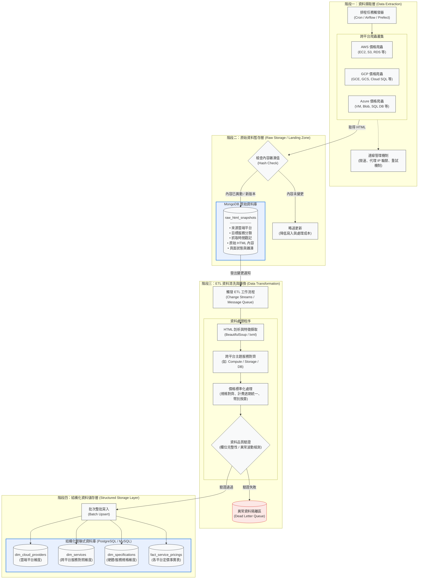

# lccnet-python-sample-project

## Session1. Python 核心語法與後端架構基本功


## Session2. 網路爬蟲工程 —— 打造 Agent 的即時感測器

### Functional Requirements

- Perform web scraping across a series of webpages by iterating through structured URL.
    - Cloud service price from Azure, GCP and AWS
- Perform ETL workflow to clean and preprocess data.
- Define SQL Schema to store preprocessed data.

### Non-functional Requirements

- Use asynchronous mechanism such as open many driver to accelerate the process.
- Due to anti-scraping mechanisms, minimize interactions that trigger a full page re-render.
- Minimize the frequency of connection between service and database

### High-Level Design



### Steps for each cloud

#### Azure

1. Enter the following link: https://azure.microsoft.com/en-us/products 
2. Locate the block including groups of title, separator and services
3. Use the visible text 'Price' to locate the elements and get links from services
4. Enter each price table of cloud service
5. Select one region and get the price table.

#### GCP

1. Enter the following link: https://cloud.google.com/pricing/list
2. Locate the main block including groups of title and the list of services
3. Get the title and extract the link from the services
4. Enter the price page of service through link
5. If the table about categories of the service is displayed, get each link of categories and enter each of the link.
6. Select on region and get all of price tables

#### AWS

### Project Structure

```
module2/
├── shared/
│   ├── utility.py          # BrowserPool、@open_playwright_page 裝飾器、close_playwright()
│   ├── mongo.py            # MongoDB 連線與 raw_html_snapshots 寫入（待實作）
│   └── db.py               # PostgreSQL 連線與 Batch Upsert（待實作）
├── automation/
│   ├── compute-azure.py    # Azure VM 定價爬蟲
│   ├── compute-gcp.py      # GCP Compute 定價爬蟲
│   └── compute-aws.py      # AWS EC2 定價爬蟲（待實作）
└── db/
    └── 01_create_table.sql # 結構化資料庫 Schema 定義
```

### Environment Setup

**Dependencies**

| Package | Version |
|---|---|
| `playwright` | 1.62.0 |
| `beautifulsoup4` | 4.14.2 |
| `lxml` | 6.0.2 |
| `nest_asyncio` | 1.6.0 |

```bash
pip install playwright==1.62.0 beautifulsoup4==4.14.2 lxml==6.0.2 nest_asyncio==1.6.0

# 安裝 Chromium（Playwright 需要）
playwright install chromium
```

**Run Scrapers**

```bash
# 從專案根目錄執行
python -m module2.automation.compute-azure
python -m module2.automation.compute-gcp
```

